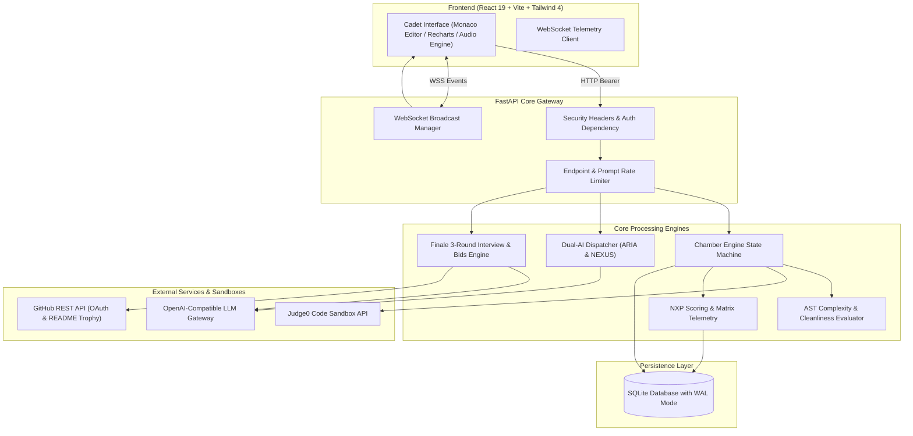

# NEXUS: Code Awakening ⚔️

> **Survive the Chambers. Outsmart the Adversary. Conquer the Technical Interview.**

**NEXUS: Code Awakening** is an adversarial technical-interview preparation arena. Upon logging in with GitHub and submitting a resume, the cadet is locked inside a 30-day gauntlet governed by **NEXUS**, a rogue AI adversary that tests algorithm mastery under intense pressure. A companion mentor AI, **ARIA**, offers progressive hints without ever writing the cadet's solution. Code is tested inside sandboxed **Judge0** containers and graded with deep **AST static analysis**. Every victory awards **NXP**, maintains streaks, and dynamically updates a 3-axis **Job-Readiness Matrix**. In the **Chamber 6 Finale**, cadets face a live 3-round interview, receive offers from fictional AI companies, and claim a trophy badge committed directly to their GitHub profile README.

---

## 🗺️ Epic Feature Mapping (Jira SCRUM-1 to SCRUM-30)

| Jira Epic | Subsystem | Key Capabilities |
|---|---|---|
| **Epic 1: Cadet Onboarding & Diagnostics** | `auth_github`, `resume_intel`, `schedule` | • GitHub OAuth login with AES-256 encrypted token persistence.<br>• PDF & DOCX resume analysis extracting skills, weaknesses, and target roles.<br>• Tailored 30-day preparation schedule with structured calendar items. |
| **Epic 2: Chamber Lifecycle & Containment** | `chamber_engine`, `ws`, `models` | • Server-authoritative state machine (`LOCKED` -> `UNLOCKED` -> `PREPARING` -> `ACTIVE` -> `EVALUATING` -> `PASSED`/`FAILED`).<br>• Server-side countdown timers, single-use reconnect tickets, and sequential chamber unlocks. |
| **Epic 3: Dual-AI Adversarial Architecture** | `aria`, `nexus_ai`, `pressure` | • **ARIA Mentor**: 3-tier progressive hints (Syntax -> Strategy -> Edge Case) with strict solution protection.<br>• **NEXUS Adversary**: Dynamic code critiques and contextual taunts.<br>• **Pressure Engine**: Synthesized audio, terminal cursor speedups, vignettes, and screen shakes as time runs out. |
| **Epic 4: Sandboxed Judging & AST Evaluation** | `judge0`, `harness`, `evaluator` | • Multi-test batch execution harness with stdout marker isolation.<br>• AST complexity estimator ($O(1)$, $O(\log n)$, $O(n)$, $O(n \log n)$, $O(n^2)$, $O(2^n)$).<br>• Code cleanliness scoring, PEP8 checks, and security AST blacklists. |
| **Epic 5: Gamification & Telemetry** | `nxp`, `matrix`, `database` | • Formulaic NXP scoring factoring chamber level, cleanliness, first-try bonus, and streak multipliers.<br>• Idempotent NXP ledger guaranteeing points are awarded once per chamber.<br>• Dynamic Job-Readiness Matrix (DSA, System Design, Cleanliness) rendered in radar charts. |
| **Epic 6: Finale Simulation & Career Trophies** | `finale`, `bids`, `github_trophy` | • Timed 3-round interview: Hard Coding, Complexity Quiz, System Design prompt.<br>• Fictional tech companies (Vantablack, Orbitfall, Lumen Forge, Gridwell, Cobalt & Finch) bidding on cadet coding styles.<br>• Automated commit of an SVG trophy badge into cadet's GitHub profile README via Octokit/REST API. |

---

## 🏛️ System Architecture



---

## ⚙️ Setup & Configuration

### Prerequisites
- Python 3.10+
- Node.js 18+
- Git

### 1. External Service Credentials
1. **GitHub OAuth Application**:
   - Go to [GitHub Developer Settings](https://github.com/settings/developers) -> **New OAuth App**.
   - Application Name: `NEXUS Arena`
   - Homepage URL: `http://localhost:5173`
   - Authorization Callback URL: `http://localhost:8000/auth/github/callback`
   - Note down `Client ID` and generate a `Client Secret`.
2. **Judge0 API**:
   - Either run Judge0 locally via Docker or acquire an API key from [RapidAPI Judge0 CE](https://rapidapi.com/hermanzdosilovic/api/judge-0-ce).
3. **LLM Provider**:
   - OpenAI or any OpenAI-compatible provider (e.g., Groq, Ollama, DeepSeek, Anthropic via proxy).

---

## 🔐 Environment Variables

Create `.env` in `backend/`:

| Variable | Description | Example / Default | Required in Production |
|---|---|---|:---:|
| `PORT` | API Server Port | `8000` | No |
| `FRONTEND_URL` | Allowed CORS Origin & OAuth Redirect Target | `http://localhost:5173` | Yes |
| `GITHUB_CLIENT_ID` | GitHub OAuth App Client ID | `Ov23li...` | Yes |
| `GITHUB_CLIENT_SECRET` | GitHub OAuth App Secret | `78d2...` | Yes |
| `GITHUB_REDIRECT_URI` | Backend Callback URL | `http://localhost:8000/auth/github/callback` | Yes |
| `ENCRYPTION_KEY` | 32-byte Hex string for AES-256 token encryption | `0123456789abcdef0123456789abcdef` | Yes |
| `JUDGE0_URL` | Judge0 Server URL | `https://judge0-ce.p.rapidapi.com` | Yes |
| `JUDGE0_API_KEY` | Judge0 API Key (if hosted) | `your_rapidapi_key` | Optional for local |
| `LLM_API_KEY` | LLM Gateway API Key | `sk-...` | Yes |
| `LLM_BASE_URL` | LLM Base URL | `https://api.openai.com/v1` | No |
| `LLM_MODEL` | LLM Model Name | `gpt-4o-mini` | No |
| `DEMO_MODE` | Enables dev backdoor and demo seeding | `false` | **NEVER in production** |
| `MOCK_EXTERNALS` | Uses canned deterministic responses for Judge0, LLM, GitHub | `false` | No |

---

## 🚀 Running the Project

### Fast 15-Minute Local Setup

#### Terminal 1: Backend
```bash
cd backend
python -m venv venv
# Windows:
venv\Scripts\activate
# Linux/macOS:
# source venv/bin/activate

pip install -r requirements.txt
pip install -r requirements-dev.txt
cp .env.example .env
uvicorn main:app --reload --port 8000
```

#### Terminal 2: Frontend
```bash
cd frontend
npm install
cp .env.example .env
npm run dev
```

Visit `http://localhost:5173` in your browser.

---

## 🎮 Demo Mode (Zero API Keys Required)

You can run and explore the entire NEXUS game without any external API keys or GitHub app credentials using **Demo Mode**:

1. Set in `backend/.env`:
   ```ini
   DEMO_MODE=true
   MOCK_EXTERNALS=true
   ```
2. Seed the demo database:
   ```bash
   cd backend
   python scripts/seed_demo.py
   ```
   *Seeds `Cadet Nova` with Chambers 1-3 PASSED, 875 NXP, active streaks, and matrix telemetry.*
3. Start backend (`uvicorn main:app --reload`) and frontend (`npm run dev`).
4. **Dev Backdoor (`/dev/unlock-chamber/{n}`)**:
   - In Demo Mode, you can unlock any Chamber on the fly:
     ```bash
     curl -X POST http://localhost:8000/dev/unlock-chamber/4 -H "Authorization: Bearer <token>"
     ```
   - *CRITICAL*: `/dev/unlock-chamber/{n}` returns `404 Not Found` when `DEMO_MODE=false`. It must **never** be enabled in production environments.

---

## 🧪 Running Tests & CI

### Backend Tests (103 Tests with Coverage)
```bash
cd backend
pytest --cov=. --cov-report=term-missing tests/
```
Target module coverage:
- `nxp.py`: **100%**
- `matrix.py`: **100%**
- `aria.py`: **90%**
- `finale.py`: **82%**
- `evaluator.py`: **81%**
- `chamber_engine.py`: **78%**
- `bids.py`: **77%**
- `github_trophy.py`: **73%**

### Frontend Linter & Production Build
```bash
cd frontend
npm run lint
npm run build
```

---

## ⚠️ Limitations & Disclaimers

1. **Complexity Estimates**: Algorithmic time and space complexities calculated by the AST evaluator are static estimations derived from loop nest depths, recursion analysis, and known built-in costs (e.g. `sorted()`). They provide guidance rather than a formal mathematical proof.
2. **Fictional Company Bids**: All hiring offers, compensation figures, and company personas (*Vantablack Systems, Orbitfall, Lumen Forge, Gridwell, Cobalt & Finch*) are completely fictional game simulations designed for immersion.
3. **GitHub Trophy Verification**: The README trophy commits made by NEXUS are authenticated using the cadet's OAuth token. GitHub determines whether a commit shows as "Verified" based on the user's GPG/SSH key configurations.