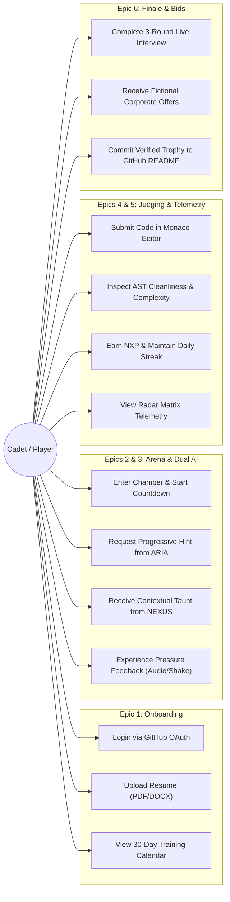
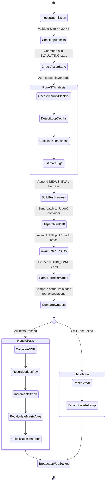
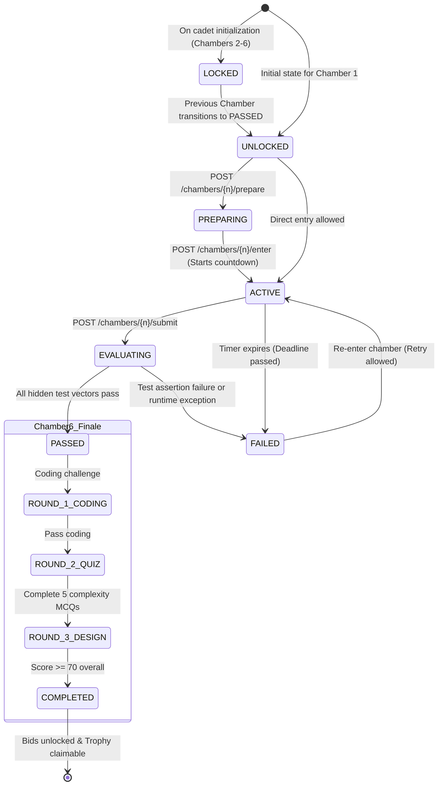
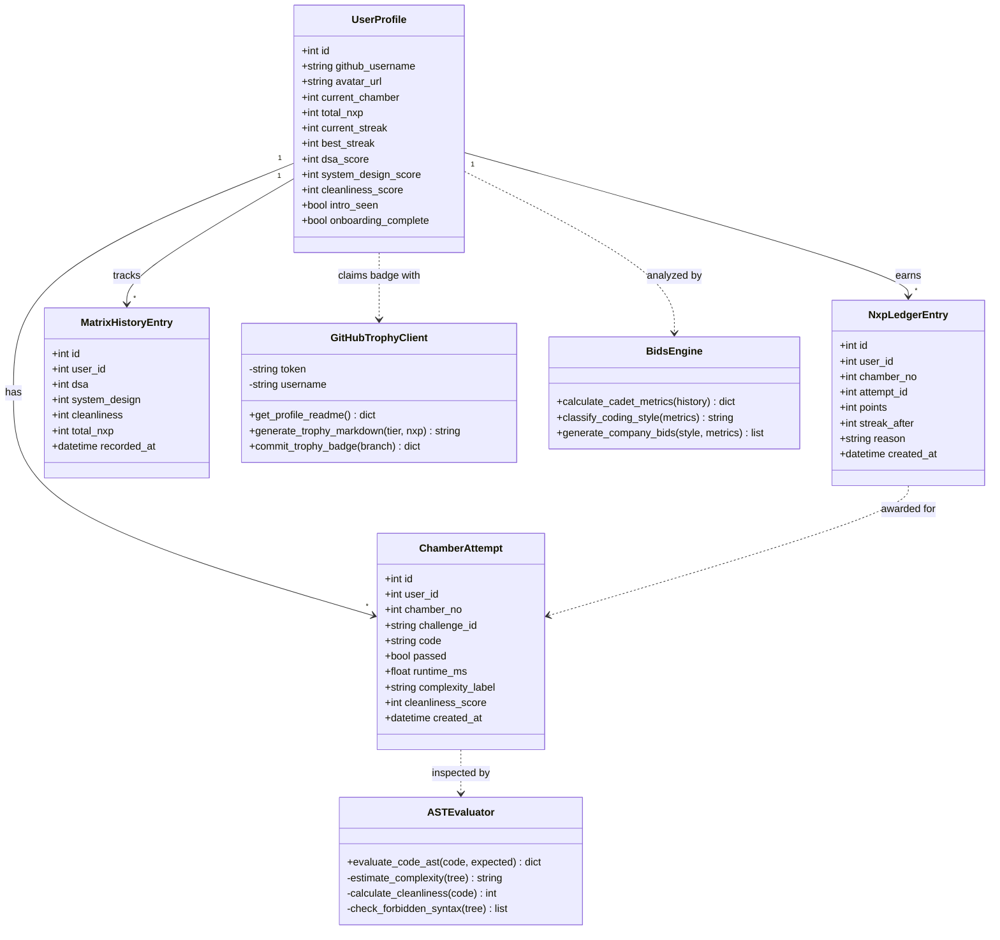

# NEXUS Architectural & System Diagrams (Phase 10)

These six Mermaid diagrams reflect the actual implementation and code patterns present throughout the NEXUS codebase.

---

## 1. Data Flow Diagram (DFD)

Traces the ingestion, evaluation, scoring, and telemetry broadcast of a cadet submission.

```mermaid
flowchart TD
    Cadet[("Cadet Browser")] -->|POST /chambers/{n}/submit| MainAPI["FastAPI Gateway (backend/main.py)"]
    MainAPI -->|Security Headers & Token Auth| AuthSec["Auth Scoping & Rate Limiter"]
    AuthSec -->|Code payload <= 20 KB| Engine["Chamber Engine (backend/chamber_engine.py)"]

    subgraph EvaluationPipeline ["Evaluation Pipeline"]
        Engine -->|AST Analysis| AST["AST Evaluator (evaluator.py)"]
        AST -->|Complexity & Cleanliness| ASTScores["Complexity Estimate & Cleanliness Score"]

        Engine -->|Harness Injection| Harn["Test Harness (harness.py)"]
        Harn -->|Prepare JSON Stdin| JudgeBatch["Judge0 Batch Payload"]
        JudgeBatch -->|HTTP Execution| J0[("Judge0 Sandbox / Mock")]
        J0 -->|Raw Stdout with Marker| ParseHarn["Marker Parser (__NEXUS_EVAL__:)"]
        ParseHarn --> TestVerification{"All Hidden Tests Passed?"}
    end

    TestVerification -->|Yes| PassedPath["Target State: PASSED"]
    TestVerification -->|No| FailedPath["Target State: FAILED"]

    PassedPath --> NXPCalc["NXP Engine (nxp.py)"]
    PassedPath --> MatrixCalc["Matrix Telemetry Engine (matrix.py)"]

    NXPCalc -->|Idempotent Insert| LedgerDB[("nxp_ledger Table")]
    MatrixCalc -->|Updated DSA / SysDesign / Cleanliness| MatrixDB[("matrix_history & player_profile")]
    Engine -->|Update State & Attempt| StateDB[("chamber_state & chamber_attempts")]

    StateDB --> WSBroadcaster["WebSocket Manager (backend/ws.py)"]
    WSBroadcaster -->|WSS Event: state & progress| Cadet
```

---

## 2. Use Case Diagram

Captures cadet interactions across the six Jira epic workflows.



---

## 3. Activity Diagram (Submission Pipeline)

Models the execution steps inside `chamber_engine.process_chamber_submission_pipeline`.



---

## 4. State Diagram (Chamber Lifecycle)

Illustrates the server-controlled lifecycle states for Chambers 1 through 6.



---

## 5. Sequence Diagram (Single Chamber Attempt)

Chronological message flow from cadet submission through evaluation, database persistence, and WebSocket push notification.

```mermaid
sequenceDiagram
    autonumber
    actor Cadet as Cadet (Frontend)
    participant API as FastAPI (main.py)
    participant Engine as chamber_engine.py
    participant Evaluator as evaluator.py
    participant Judge as judge0.py
    participant NXP as nxp.py
    participant DB as SQLite (database.py)
    participant WS as WebSocket Hub (ws.py)

    Cadet->>API: POST /chambers/1/submit {code, language}
    API->>API: Verify Auth & Rate Limit
    API->>Engine: record_chamber_submission(user_id, 1, code)
    Engine->>DB: Set state = EVALUATING
    Engine->>WS: Broadcast {type: "state", state: "EVALUATING"}
    WS-->>Cadet: Render spinner / evaluate status
    API-->>Cadet: 202 Accepted {state: "EVALUATING"}

    rect rgb(20, 25, 35)
        Note over Engine,Judge: Async Pipeline Execution
        Engine->>Evaluator: evaluate_code_ast(code, expected="O(n)")
        Evaluator-->>Engine: {complexity: "O(n)", cleanliness: 92, inefficient: false}

        Engine->>Judge: execute_batch(submissions)
        Judge-->>Engine: [{stdout: "__NEXUS_EVAL__:{\"result\": 2}"}, ...]

        Engine->>Engine: Compare outputs against hidden_tests
        Note over Engine: All tests PASSED
        Engine->>NXP: calculate_nxp(chamber=1, clean=92, first_try=True, streak=0)
        NXP-->>Engine: points = 143

        Engine->>DB: record_nxp_ledger(points=143, streak=1)
        Engine->>DB: update_matrix_history(dsa=75, sys=60, clean=92)
        Engine->>DB: set_chamber_state(1, "PASSED")
        Engine->>DB: set_chamber_state(2, "UNLOCKED")
    end

    Engine->>WS: Broadcast {type: "progress", state: "PASSED", nxp: 143}
    WS-->>Cadet: Receive progress event (Play victory SFX, show Matrix delta)
```



---

## 6. Class Diagram

Object hierarchy, model relationships, and domain contracts implemented in the system.


